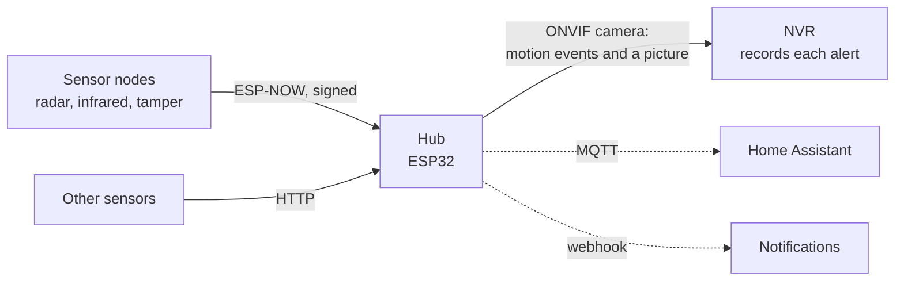
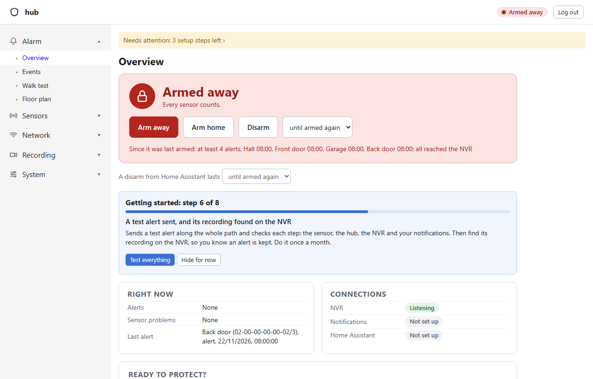

# esp32_sensors2onvif

A stand-alone ESP32 hub that receives alerts from ESP sensor nodes and presents itself as a normal ONVIF
camera. Add it to an NVR on any free channel. Each alert becomes a searchable motion record, and the picture
names the sensor that fired. The firmware knows nothing about NVR channels.

[](https://github.com/sjfaustino/esp32_sensors2onvif/actions/workflows/checks.yml)
[](https://github.com/sjfaustino/esp32_sensors2onvif/actions/workflows/codeql.yml)
[](https://scorecard.dev/viewer/?uri=github.com/sjfaustino/esp32_sensors2onvif)
[](https://github.com/sjfaustino/esp32_sensors2onvif/releases)





## What you need

- **A hub:** an ESP32 board with 16 MB of flash, powered by USB, ideally from the same UPS as the NVR. One with 4 MB, or an
  ESP32-S3, works too.
- **An NVR** that takes ONVIF cameras, with a free channel.
- **Sensors:** [sensor nodes](https://github.com/sjfaustino/esp32_sensor_node) on ESP32-C3, ESP32-C6 or classic ESP32
  boards, with a radar or infrared sensor, on a battery or mains power; or any device that can make an HTTP request.
- **Chrome or Edge** to flash the hub the first time, from the
  [releases](https://github.com/sjfaustino/esp32_sensors2onvif/releases). Later firmware goes on from the hub's own page.

## Quick start

1. Write the release's `-full.bin` for your board to the hub, as the
   [user guide](docs/user-guide.md#setting-up-a-hub) says.
2. Join the hub's network, `esp-alarmhub-setup`, choose the hub password and your Wi-Fi network on the page that opens.
3. Open the hub's page, `http://esp-alarmhub.local`.
4. Add the hub to the NVR as an ONVIF camera, by its address, on port 8899, with user `admin` and the hub password
   (see [Adding it to the NVR](docs/user-guide.md#adding-it-to-the-nvr)).
5. Pair a node on **Nodes and pairing**, or add an HTTP sensor there.
6. Work through **Ready to protect?** on the Overview, then press **Test everything** and check that the NVR recorded it.

## Documents

- [User guide](docs/user-guide.md): setting up, every page, alerts and past events, notifications, Home Assistant,
  pairing nodes, HTTP sensors and the NVR.
- [How it works](docs/how-it-works.md): for whoever changes the code.
- [Protocol](docs/protocol.md): the ESP-NOW messages between the hub and its nodes.
- [Threat model](docs/threat-model.md): who might try to defeat the hub, and what it does and cannot do about each.
- [Sensor nodes](https://github.com/sjfaustino/esp32_sensor_node): their hardware and firmware.
- [Changelog](CHANGELOG.md), [security policy](SECURITY.md) and [third-party notices](THIRD_PARTY_NOTICES.md).

## Building and testing

No hardware or NVR needed. Everything runs on loopback.

```
pio test -e native
pio run -e host
python tools/e2e_test.py
python tools/e2e_pages.py    # needs: pip install playwright==1.52.0, then python -m playwright install chromium
python tools/screenshots.py  # the pictures in docs/images, taken again after a page changes
```

`tools/e2e_test.py` can also test a flashed board. Its header explains how. Its parts are the other `tools/e2e_*.py`
files beside it, but for `tools/e2e_pages.py`, which opens the pages in a real browser and checks that arming,
disarming and the test alerts work from them, and that a refused change never leaves the page showing what was asked
for instead of what the hub is. It runs against the PC build only, as it changes the arm mode. The unit tests are a file per
subject in `test/test_core`. The unit tests include a fuzz test that feeds
every parser of what arrives from outside thousands of changed inputs. The C++ follows `.clang-format`; check it with
clang-format 19 as the CI does.

## Licence

Copyright (c) 2026 Sergio Faustino. All rights reserved: the code is published to be read and evaluated, and using it
needs written permission, as [LICENSE](LICENSE) says. Bug reports and ideas are welcome as issues; see
[CONTRIBUTING.md](CONTRIBUTING.md), and [SECURITY.md](SECURITY.md) for reporting a vulnerability. The firmware also
contains software by others under their own licences, listed in [THIRD_PARTY_NOTICES.md](THIRD_PARTY_NOTICES.md).
