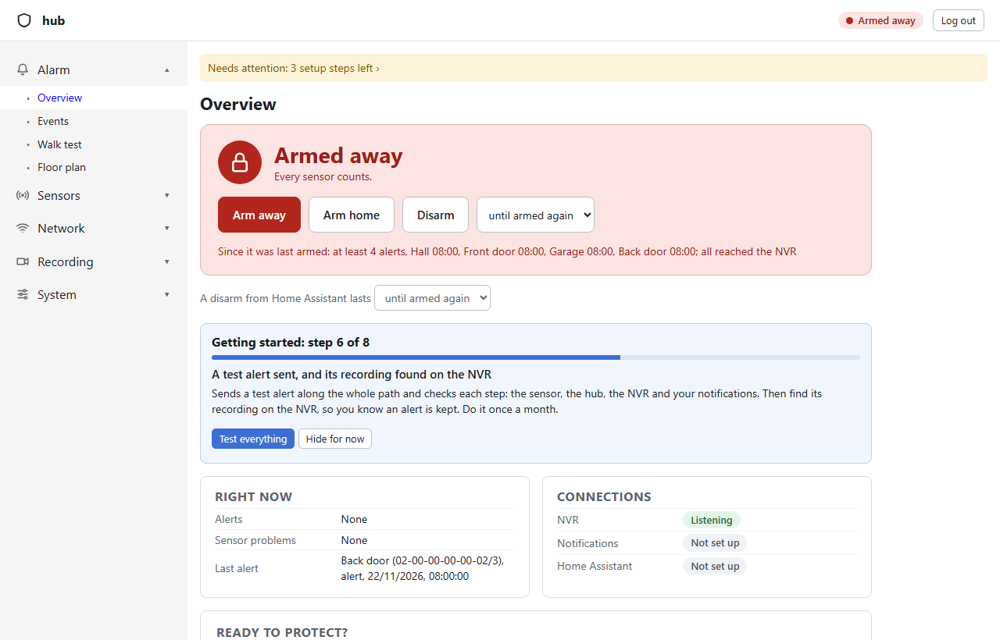
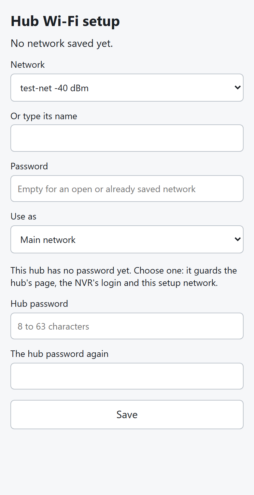
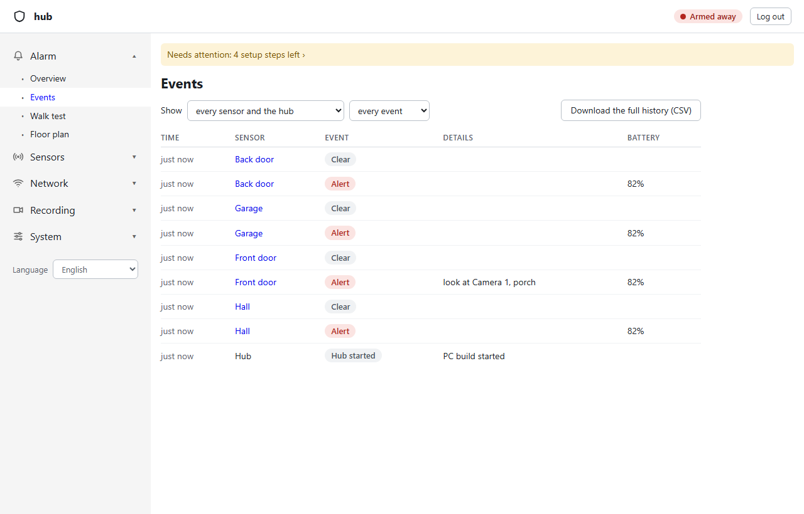
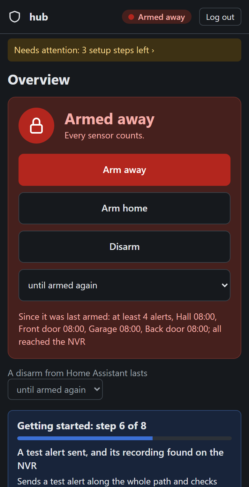
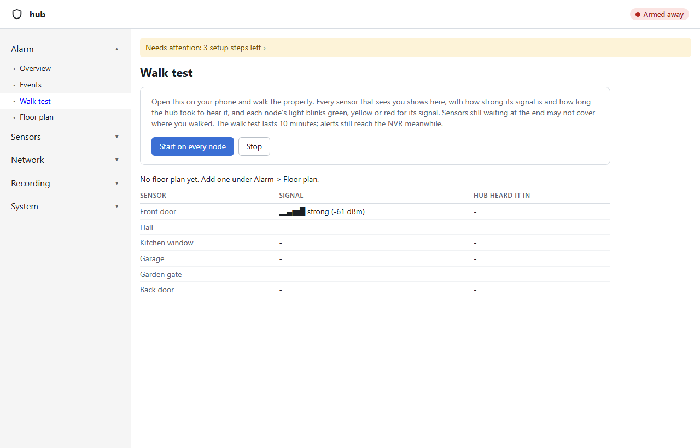
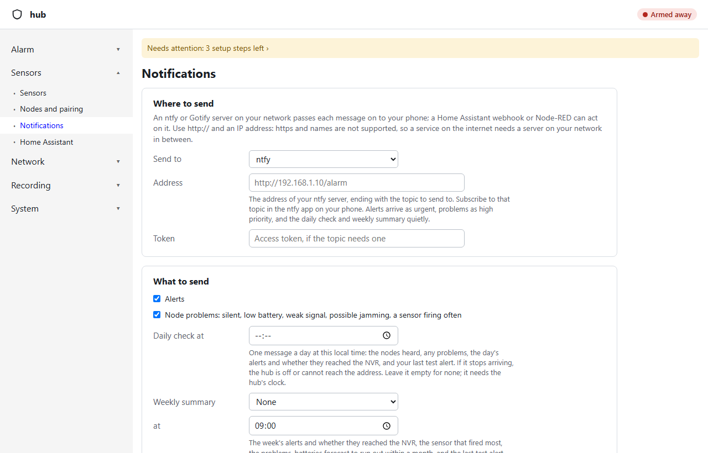
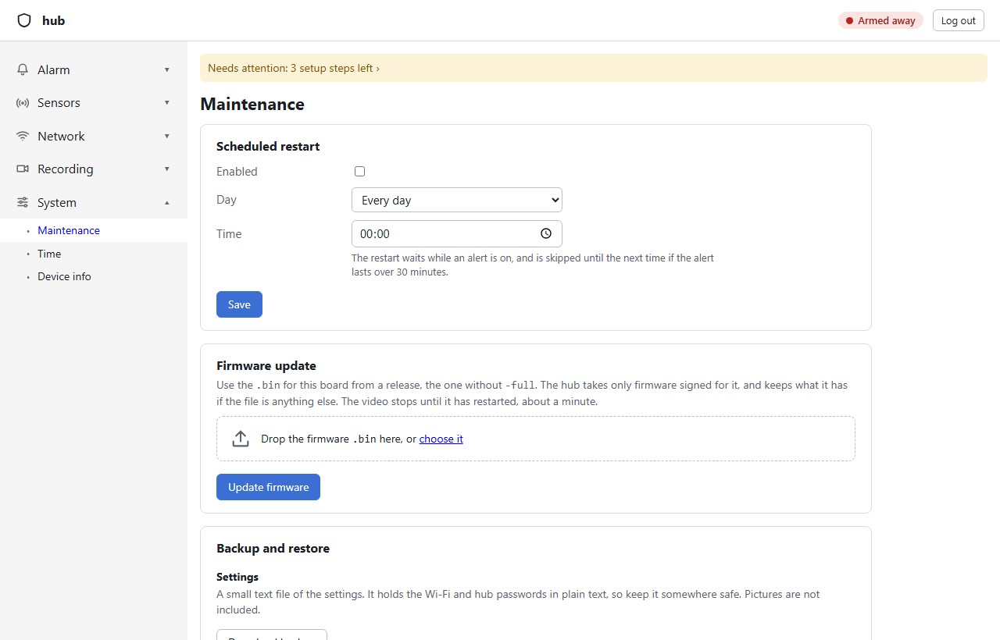
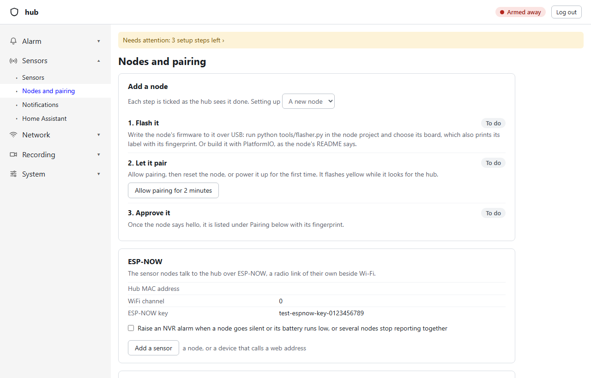
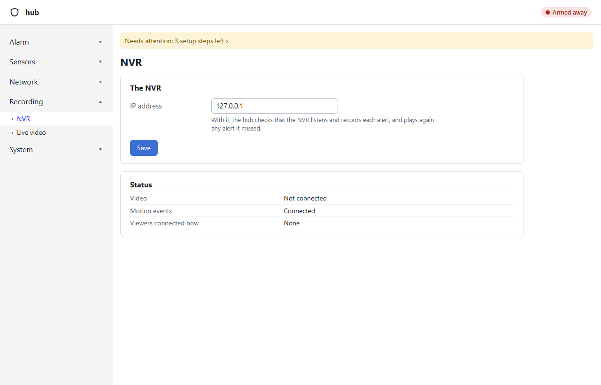
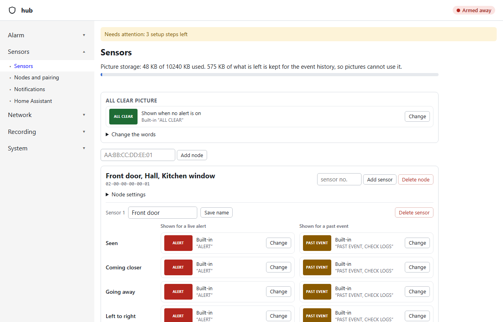

# User guide

Everything the hub does and how to set it, page by page. The [README](../README.md) gets a hub going;
[how-it-works.md](how-it-works.md) is for whoever changes the code, and [protocol.md](protocol.md) describes the
messages between the hub and its nodes.



## Setting up a hub

### From a release

1. Download `sensors2onvif-<version>-<board>-full.bin` from the
   [releases](https://github.com/sjfaustino/esp32_sensors2onvif/releases): `esp32_16mb` for an ESP32 with 16 MB of
   flash, `esp32dev` for one with 4 MB, `esp32s3` for an ESP32-S3.
2. Write it to the board at address 0 with [ESP Tool](https://espressif.github.io/esptool-js/) in Chrome or Edge:
   connect, press **Erase Flash**, add the file at address `0x0`, and press **Program**. `esptool.py write_flash 0x0
   <file>` does the same from a PC.
3. The hub opens its own Wi-Fi network, `esp-alarmhub-setup`. Join it from a phone or laptop, and the setup page opens
   by itself, or browse to `http://192.168.4.1`.
4. Choose the hub password, then your Wi-Fi network and its password, and press **Save**. The hub restarts and joins
   that network.



The hub password guards its page, the NVR's login and, from then on, the setup network. Until one is chosen, the setup
network is open, so set a new hub up as soon as it first starts.

### From source

1. Copy `include/secrets.example.h` to `include/secrets.h`. Everything in it may stay empty, and the hub then starts as
   one from a release does. `WIFI_SSID` and `WIFI_PASSWORD` give the first network to try, `WEB_PASSWORD` the hub
   password, and `SETUP_AP_PASSWORD` a fixed password for the setup network instead of the hub password.
2. Flash with `pio run -t upload`, which targets a regular ESP32 with 16 MB of flash. Add `-e esp32dev` for one with
   4 MB, or `-e esp32s3` for an ESP32-S3. Build from VS Code or PowerShell, because the pioarduino toolchain setup
   refuses to run under Git Bash.

A 4 MB board keeps a shorter event history, about 650 events, so that it always fits beside a few pictures; should
storage still fill, the older half of the history gives way, since a report that cannot be saved cannot be confirmed.

### Finding the hub

Open `http://esp-alarmhub.local` from a device on the same network as the hub. The name does not work through a VPN,
and some devices cannot resolve `.local` names. In those cases use the address your router gave the hub, or the one
printed on the serial console once Wi-Fi is up, as `http://<address>/`. Add the hub to the NVR by address, not by name.

### IP address

**Network > Network** switches between DHCP and a fixed address. A fixed address is used only on the WiFi network the
hub was connected to when it was saved, and other networks use DHCP. If the router cannot be found from a fixed address, the
hub forgets it about two minutes after joining and goes back to DHCP.

### Changing the Wi-Fi network

The hub keeps a main and a backup network. It tries the main network for 30 seconds, then the backup for 30 seconds. If
the backup joins, it becomes the main network and the old main becomes the backup.

If neither works, or none is saved, the hub opens its own network, `esp-alarmhub-setup`, protected by the hub password.
It uses WPA3, which phones from 2019 on and Windows 10 and macOS from that time on can join; an older device cannot.
With WPA3, someone who records you joining cannot try passwords on their own computer, as they could with WPA2.
A blank hub has no password yet, so its setup network is open until one is chosen.
Join it from a phone or laptop and the setup page opens by itself, or browse to `http://192.168.4.1`. Choose a network, and
whether it is the main or the backup. A new main network moves the previous main to the backup. Saved settings replace any
in `secrets.h` and survive reflashing.

The setup network closes as soon as the hub rejoins Wi-Fi, and the hub keeps trying both networks while nobody is connected
to the setup network. Networks can also be changed at any time from **Network > Wi-Fi** on the web page.

## Events and alerts



**Alarm > Events** lists the last 64 events, kept across restarts. **Download the full history (CSV)** gives
about the last 5400, in UTC. A download cut short, by a restart or a dropped connection, shows as failed in the browser,
so a complete file is the whole history. `/api/events.csv?sensor=AA-BB-CC-DD-EE-01/1&days=7` gives one sensor's events
over the last days, as each sensor's page uses; either part can be left out. The hub sends one download at a time and
answers 503 to another meanwhile. A sensor can be given a name on the Sensors page, which then appears on the ESP-NOW and
Events pages. Updating from older firmware keeps its history.

A node that stays silent for 3 hours, counted from the last restart if it has not reported since, reports 20% battery or
less, or whose ESP-NOW signal stays below -80 dBm, is logged as an event. The Nodes and pairing page can also raise an NVR alarm for
silence, low battery and nodes stopping together. A sensor that is unplugged, smashed or taken is only noticed once it has been silent that long,
so it should be a little over the time between the node's regular reports. A node that says how often it reports (see
"Node info" below) sets it for you; otherwise, or to change it, set **Report this node silent after** under its Node
settings, from 1 minute to 7 days.

A node that sends node info is also logged when it restarts for a fault, such as a crash, its watchdog or a brownout:
**node restarted by a fault**. That shows a weak battery or a bad wire before the node goes silent. From its battery
readings the hub works out how long the battery will last, shown on the Nodes and pairing page, and logs **battery running out**
once that is under a week. It keeps a reading every 6 hours in `battery.txt` in the node's folder, and needs the hub's
clock set, at least 4 readings over 3 days, and a fall of at least 3 points. A rise of 10 points or more, a new or
recharged battery, starts the readings again. A node on a solar panel that keeps up gets no forecast.

Batteries run out one node at a time. When two or more nodes that had been reporting steadily stop together, within
half an hour of each other, the hub logs **possible jamming** as one of its own events, with how many, and sends it with
node problems; with the Nodes and pairing page's NVR alarm on, the NVR records it as an alert from each of them. A node counts as
stopped once its regular report is a fifth of its report time late, and a minute more, so how soon this is noticed
depends on how often the nodes report: every 2 hours, the nodes' default, it takes about two and a half hours, little
sooner than "went silent"; every 10 minutes, set under each node's Node settings, about 12 minutes. Only nodes that say
how often they report, or are told, count, and only once they have reported since the hub started.

A sensor that fires 20 times within an hour is logged once as **firing often** and sent with node problems: it is more
likely faulty or badly aimed than watching that many intruders, and its alerts bury the real ones. Every alert still
goes to the NVR. It can be logged again after an hour with fewer than 5.

The hub cannot report its own death: while it has no power or no Wi-Fi, nothing reaches the NVR, and the hub logs how long
it was off only once it is back. Turn on the NVR's video-loss alarm for the hub's channel so the NVR notices, and power the
hub from a small UPS.

The hub checks that each alert reached the NVR. If the NVR was not listening, the history gets **Alert not delivered**
and Notifications sends it; the alert is kept, and once the NVR listens again it plays as a past event, so the NVR
still records that something happened. Set the NVR's address on the NVR page, or any device subscribed to the hub's
events counts as the NVR; the page warns at the top until you do. Past events, and alerts kept for the NVR, play only while the NVR is listening, so after a power cut they wait for it to
reconnect instead of being logged as missed. When the NVR has not been listening for 3 minutes,
the hub logs **NVR stopped listening**, and **NVR listening again** when it is back. If the hub rejoins its Wi-Fi after
losing it, it logs **network lost** with how long, because someone may be keeping it off on purpose.

Delivered is all the hub can see. Whether the NVR then records depends on its own settings for the hub's channel: motion
detection on, and recording and logging on motion. Check them when adding the hub, and check a recording after any NVR
update or reset.

Each time the hub starts it logs **Hub started** with the reason, such as a power cut or a firmware update, and how long
it was off, to within 10 minutes after a power cut. Three starts within an hour that nobody asked for, such as crashes,
watchdog restarts or power cuts, are logged as **restarting often** and sent like the hub's other events, as something
keeps stopping it. Updates, the restart button and new settings do not count.

The Events page can show one sensor's events, or only alerts, problems or the hub's own events.

**Alert settings** under each sensor on the Sensors page set how long its alert lasts, instead of the hub's 10 seconds, and
quiet hours in local time. During quiet hours that sensor's alerts are logged as "alert in quiet hours" but are not sent to the
NVR or to Notifications. Quiet hours need the clock to be set; until it is, alerts always go through. **Camera to look at**
names the NVR camera that covers the sensor, such as "Camera 3, garden": its alert notifications end with "look at Camera
3, garden", the JSON has it as `camera`, and the Events page shows it beside each alert, so you know which recording to
watch. The settings are kept in `settings.txt` in the sensor's folder.

The whole hub can be disarmed, on the Overview page or from Home Assistant. Disarmed, every alert is logged as "alert while
disarmed" but is not sent to the NVR or to Notifications, and every page says so at the top. A late report of something
that happened before the disarm still goes through, and so does one whose time is not known. Arming and disarming are
logged as hub events, with where they came from. The setting survives restarts and resets to armed with the other
settings; it is not in backups, so restoring one never disarms the hub.

The hub can also be **armed home**, for when someone is in: each sensor's Alert settings mark it as perimeter, the
default, or interior. Armed home, an interior sensor's alerts are logged as "alert while armed home" but not sent to the
NVR, while perimeter sensors count as when armed away. A late report counts if what it reports happened while its sensor
still counted: for an interior sensor, before the hub left armed away; for a perimeter one, before it was disarmed.

A disarm can last a set time, from 30 minutes to a day, after which the hub arms itself again and logs "armed" from the
re-arm timer, armed away, so forgetting to arm it cannot leave the house unwatched. The Overview page asks how long each time;
**A disarm from Home Assistant lasts** sets how long one from Home Assistant does. "Until armed again" turns the timer
off. A timed disarm survives a restart, but if the hub cannot tell how much of it is left, because its clock was not set
when the disarm began or is not set within two minutes of the restart, it arms itself at once.

**Alarm > Overview**, the page the hub opens on, starts with the alarm's state in large type and its colour: red for
armed away, amber for armed home, green for disarmed, with an icon and words that say the same, and the buttons to
change it below. The mode's own button is filled in. A change is confirmed in a notice at the foot of the page, with
**Undo** to go back to the mode before; a disarm asks first, in the page. Under it, **Right now** lists any alert
running and any sensor that is silent, on a low battery, on a weak signal or having messages refused, and the last
alert, and **Connections** whether the NVR is listening and how the notifications and Home Assistant are set up.

The bar across the top of every page shows the hub's name and the alarm's state in the same colours, and links to the
Overview. A line below it sums the hub up: green when all is well, yellow when something needs attention (disarmed, a
sensor problem, or setup left to do, such as the NVR's address), red when the NVR is not listening, so alerts are not recorded.
It links to the Overview. Until everything is done, the Overview starts with **Getting started**: the next step left,
what to do and why, and a button that goes there. The steps are a hub password of your own rather than one built into
the firmware, the clock set, the NVR's address set and the NVR listening, a sensor heard, a test alert in the last
month, notifications or Home Assistant, and a daily check. **Hide for now** puts them away; they stay listed under
**Ready to protect?** at the foot of the Overview, with a link to put each right and one to show them a step at a time
again. Both go once all are ticked, and come back if one slips.

The pages follow the device's light or dark setting, and on a phone wide tables scroll sideways.



**Alarm > Walk test** is for walking the property with a phone. **Start on every node** turns on every node's walk
test for 10 minutes; each sensor that sees you is ticked, with its signal and how long the hub took to hear it, while
each node's light blinks its signal too. Sensors still waiting at the end may not cover where you walked. Alerts still
reach the NVR meanwhile. With a floor plan, the walk test shows it too, each sensor lighting up as it fires.



**Alarm > Floor plan** shows a picture of the property with each sensor where it is: red while it fires, amber with a
problem, grey until it is first heard. **Choose a picture** takes any image, such as a photo of a drawing or a
screenshot of a map; the browser makes it a JPEG of at most 30 KB, as the hub keeps it in its picture buffer, smaller
and coarser until it fits. Then choose each sensor and tap where it is. The hub keeps the picture as `plan.jpg` and the
places as `plan.json`, at the top of its storage, and a full backup carries both. Tapping a sensor on the plan opens its
page.

Each sensor has a page of its own, opened by its name anywhere: on the Overview, the Events and Nodes and pairing pages,
and the floor plan. It shows how the sensor is now, when it fired over the last 7 days by hour of the day, its battery
readings over time, and its latest events, each explained, with a button for a test alert.

**Test everything**, on the Overview, sends a test alert from a sensor you choose and checks each step it takes: that
the hub sent it, that the NVR was listening, that Notifications delivered its message, and that Home Assistant is
connected. It ends by saying what recording to look for on the NVR, the one step the hub cannot check.

Under its arm controls the Overview says what happened since the hub was armed, or, once disarmed, while it was:
"While armed, 23:10 to 07:02: 2 alerts, Back door 02:14, Gate 02:15; all reached the NVR". It reads the latest 64
events, so after a busy night it says "at least". On the Events page, tapping an event says what it means and what to
do; the Overview's problems carry a short next step too.

**Send test alert**, in each sensor's Alert settings and as a button on each sensor in Home Assistant, makes a real alert
from that sensor, whatever the alarm is set to: the NVR records it with that sensor's picture, the hub checks the NVR got
it, and Notifications and Home Assistant get it as `test alert`. Use it after changing the NVR, the network or an
automation, and check that a recording appeared. It is logged as a test, so it is never mistaken for a real alert.

## Notifications



**Sensors > Notifications** sends each alert, and optionally each node problem, to a server on your network.
**Send to** chooses how:

- **ntfy**: a self-hosted [ntfy](https://ntfy.sh) server passes each message to the ntfy app on your phone. The address
  ends with the topic, as `http://192.168.1.10/alarm`; subscribe to that topic in the app. Each message has a title,
  such as `esp-alarmhub.local: alert: Gate`, and a priority: alerts and alerts the NVR missed are urgent, node and hub
  problems high, a test alert middling, and arming, the daily check and the weekly summary low. Give an access token if
  the topic needs one.
- **Gotify**: a [Gotify](https://gotify.net) server and its phone app. The address ends with `/message`, and the token
  is an application's, from Gotify's Apps page. Alerts arrive with priority 10.
- **Home Assistant, Node-RED or other (JSON)**: the hub posts JSON like
  `{"event":"alert","sensor":"AA-BB-CC-DD-EE-01/1","name":"Gate","battery":80,"camera":"Camera 3","time":"2026-11-11T18:00:12Z","hub":"esp-alarmhub.local","message":"Gate (AA-BB-CC-DD-EE-01/1): alert; look at Camera 3"}`.
  In Home Assistant, use a webhook trigger, at `http://<Home Assistant>:8123/api/webhook/<id>`.
- **Other (plain text)**: just the message.

A saved token is never shown again; leave the field blank to keep it, or tick **Forget the saved token**. Services on the
internet, such as Telegram, Pushover or ntfy.sh itself, need https, which the hub does not have: reach them through
a server on your network, such as Home Assistant or a self-hosted ntfy that forwards to ntfy.sh. Events are `alert`, `delayed alert`, `went silent`, `low battery`, `weak signal`,
`node restarted by a fault`, `battery running out`, `possible jamming`, `firing often`, `alert not delivered`, `delayed alert not delivered`, `NVR not listening`,
`NVR listening again`, `hub started`, `network lost`, `armed`, `disarmed` and `test`.
The hub's own events have `"sensor":"hub"` and an empty name, and give the reason a hub started as `"detail"`. An alert not delivered is sent
whenever alerts or node problems are; the hub's own events are sent with node problems.
**Daily check at** sends one message a day at that local time, as event `daily check` from `"sensor":"hub"`: how many
nodes were heard in the last day (`nodes`, `heard`), the sensors with a problem (`problems`), the day's alerts and how many
did not reach the NVR (`alerts`, `notDelivered`; `allCounted` is false when more happened than the hub keeps in memory),
whether the NVR is listening, how the hub is armed, and how long since the last test alert (`testAgo_s`). It shows the
system works; if it stops arriving, the hub is off, cut off from the network, or its clock is not set. Leave the time
empty for none.
**Weekly summary** sends one message a week on that day and local time, as event `weekly summary`: the week's alerts and
how many did not reach the NVR (`alerts`, `notDelivered`), the sensor that fired most (`busiest`, `busiestAlerts`),
the alerts only logged while disarmed, armed home or in quiet hours (`held`), test alerts and problems reported
(`tests`, `problems`), the batteries forecast to run out within a month (`batteries`), the problems now
(`problemsNow`), whether the NVR is listening, how the hub is armed, and the last test alert. It is counted from the
history on storage, up to 2000 events; `allCounted` is false when the history did not reach back a week.
**Send the weekly summary now** sends one at once, to see what it says.
The address must be `http://` with an IP address, because the hub has no name lookup or TLS for this. Messages go one at a
time; up to 8 wait, and the page shows how the last one went.

## Home Assistant

**Sensors > Home Assistant** connects the hub to an MQTT broker, and Home Assistant then finds the hub and each
sensor by itself. In Home Assistant, install the Mosquitto broker add-on and the MQTT integration, make a Home Assistant
user for the hub, and enter the broker's IP address, that user and its password here. The hub has no name lookup, so the
address must be an IP address, and the connection is not encrypted.

Home Assistant then shows:

- **The hub**, with an Alert sensor that is on while any sensor's alert is, an NVR listening sensor, an Alarm panel, and
  an Events entity for the hub's own events: `hub started`, `network lost`, `NVR not listening`, `NVR listening again`,
  `armed`, `armed home` and `disarmed`. The Alarm panel arms away or home and shows disarmed, armed away, armed home,
  or triggered while an alert is on, works with
  Home Assistant's alarm cards and keypads, and asks for no code, so limit who can use it in Home Assistant. A disarm from
  it lasts the hub's re-arm time, and the hub state's `rearm_at` says when it ends. Anyone who can publish to the broker
  can use the panel too, so give the broker a login. The Armed switch of earlier firmware is taken away.
- **The hub's health**, as diagnostic sensors on the hub, sent every minute: free memory, the lowest it has been, the
  largest free block and the smallest that has been since the start, the work dropped for lack of memory, ESP-NOW
  messages dropped while busy, the Wi-Fi signal, and when the hub last started. Home Assistant keeps their history, so
  memory that keeps shrinking over days shows long before it matters.
- **Each sensor** as its own device, named as on the Sensors page, with Alert (on for as long as the NVR is shown the
  alert), Battery, Signal, Problem (silent, low battery or weak signal) and an Events entity carrying every event of
  its history, with the same names as the Events page, and a Send test alert button.

The hub leaves "offline" with the broker as its last will, so Home Assistant marks the hub and every sensor unavailable
the moment the hub's connection drops: from a power cut, a crash, or someone keeping it off the network. An automation on
that is the warning the hub cannot send itself. Events are sent with MQTT's acknowledgement, and one not acknowledged is
sent again after reconnecting; up to the newest 64 wait while the broker is away. Past events replaying for the NVR are
not shown as alerts, since they are not happening now; they arrive as `delayed alert` events instead.

The topics are under `sensors2onvif/<serial number>/`, and the discovery messages under `homeassistant/`. A sensor
deleted on the hub is taken away from Home Assistant too, unless the hub restarts before it next reaches the broker; then
delete it in Home Assistant.

### Automations to start from

Home Assistant names each entity after its device and itself, such as `alarm_control_panel.esp_alarmhub_alarm` for
the hub's panel and `event.sensor_02_00_00_00_77_01_1_events` for a sensor's events; check yours under Settings >
Devices & services > MQTT, and replace the names below. `notify.mobile_app_phone` is the Home Assistant app on your
phone. Paste each under Settings > Automations & scenes > Create automation > Edit in YAML.

The hub gone, which it cannot report itself: a power cut, a crash, or someone keeping it off the network.

```yaml
alias: Alarm hub offline
triggers:
  - trigger: state
    entity_id: alarm_control_panel.esp_alarmhub_alarm
    to: unavailable
    for: "00:02:00"
actions:
  - action: notify.mobile_app_phone
    data:
      title: Alarm hub offline
      message: The hub has been off the network for 2 minutes. Alerts are not reaching the NVR.
```

An alert while armed, saying which sensor. List each sensor's events entity.

```yaml
alias: Alarm alert
triggers:
  - trigger: state
    entity_id:
      - event.sensor_02_00_00_00_77_01_1_events
conditions:
  - condition: template
    value_template: "{{ trigger.to_state.attributes.event_type in ['alert', 'delayed alert'] }}"
actions:
  - action: notify.mobile_app_phone
    data:
      title: Alarm
      message: "{{ trigger.to_state.attributes.message }}"
```

Problems: a sensor silent, on a low battery or a weak signal, a node restarted by a fault or its battery running out,
nodes stopping together, a sensor firing often, an alert the NVR missed, or the NVR not listening.

```yaml
alias: Alarm problem
triggers:
  - trigger: state
    entity_id:
      - event.sensor_02_00_00_00_77_01_1_events
      - event.esp_alarmhub_events
conditions:
  - condition: template
    value_template: >-
      {{ trigger.to_state.attributes.event_type in ['went silent', 'low battery', 'weak signal',
         'node restarted by a fault', 'battery running out', 'possible jamming', 'firing often',
         'alert not delivered', 'delayed alert not delivered', 'NVR not listening'] }}
actions:
  - action: notify.mobile_app_phone
    data:
      title: Alarm problem
      message: "{{ trigger.to_state.attributes.message }}"
```

Armed away when everyone has left, and armed home late at night if still disarmed. Disarming is left to a person on
purpose: a phone's location can be wrong.

```yaml
alias: Arm when everyone leaves
triggers:
  - trigger: numeric_state
    entity_id: zone.home
    below: 1
actions:
  - action: alarm_control_panel.alarm_arm_away
    target:
      entity_id: alarm_control_panel.esp_alarmhub_alarm
---
alias: Arm home at night
triggers:
  - trigger: time
    at: "23:30:00"
conditions:
  - condition: state
    entity_id: alarm_control_panel.esp_alarmhub_alarm
    state: disarmed
actions:
  - action: alarm_control_panel.alarm_arm_home
    target:
      entity_id: alarm_control_panel.esp_alarmhub_alarm
```

The last block holds two automations; paste each part separately.

## ONVIF thumbnails

ONVIF clients ask the hub for a JPEG of the current picture. The hub stores only H.264 and cannot convert it, so the browser
saves a small JPEG beside each picture it uploads. **Create missing thumbnails** on the Sensors page makes them for pictures
that have none. A picture without a thumbnail shows the built-in All Clear, Alert or Past Event image instead.

## Security

One hub password, with the user name `admin`, protects the web page, ONVIF, RTSP and the setup network. It is chosen
on the setup page the first time, and can be changed, but not turned off, under **Network > HTTP**; a new one
has 8 to 63 characters. A hub built from source can take its first one from `WEB_PASSWORD` in `secrets.h`. An NVR needs
the same user and password on its channel. ONVIF clients may ask for the clock and capabilities before logging in, as
ONVIF requires. A hub that has no password, from an older firmware that could turn it off, asks for one at the top of
every page until it has one; meanwhile anyone on the network could change it and watch its video. Alerts reach the NVR
all the same.

HTTP sensor reports need `&token=<value>`. The hub makes a token the first time it starts and shows it on the HTTP page.
ESP-NOW reports are signed with a separate key instead; see "Sensor input over ESP-NOW".

Ten wrong passwords in a row from one address lock it out for a minute, then longer for each further one, up to 15
minutes. The web page answers only to the hub's address, its own name with `.local` or a home router's usual ending,
and the **Other names** on the HTTP page: add the name your router gives the hub there if you use it. A refused name
gets a reply saying so. Details are in [docs/how-it-works.md](how-it-works.md).

Passwords travel over the network unencrypted, as HTTP, ONVIF and RTSP between local devices usually do, and are kept on
the hub's flash unencrypted, so someone who takes the hub can read the Wi-Fi password, the hub password and the ESP-NOW key.
Keep the hub out of reach.

## System



**Maintenance** schedules a restart, restarts the hub now, updates the firmware from a `firmware.bin` file, downloads and
restores a settings backup (which holds the passwords in plain text), makes and restores a full backup, and resets the settings.
A scheduled restart waits while an alert is on, so it never cuts an NVR record short; if the alert has not ended within
30 minutes, that restart is skipped until the next time.
The hub takes only firmware signed with the project's key, as each release's `.bin` is, so the hub password alone
cannot put other firmware on it; anything else is refused and nothing changes. A firmware built by someone else can be
put on over the board's USB cable, as a new hub is set up.
A new firmware is kept only once it has done the hub's work: stayed on the network for a minute, started ESP-NOW, and,
if the NVR was listening when the update began, got it listening again. If it crashes, stalls or loses the network
first, the power fails meanwhile, or it has not managed within 10 minutes, the hub goes back to the previous firmware
and Device Info says so. A reset erases the saved WiFi
networks, ports, name, web password, fixed address, time, notification and MQTT settings, arms the hub, and keeps the pictures, the sensor nodes,
and the ESP-NOW key and token that sensors use.

**New keys** makes a new ESP-NOW key, pairing key, sensor token and snapshot address, then restarts: the keys are
deleted and the start makes new ones, as on the first. Every sensor node must then be set up or paired again, so use it
only if a key may have got out. A settings backup made before brings the old keys back if restored.

A **full backup** is one `.tar` file with the settings, every picture and thumbnail, each sensor's name and alert settings, each node's settings, and the floor plan.
Your browser builds it one file at a time, so it works however many pictures there are. Restoring adds the nodes, sensors and
pictures in it, replacing any with the same name and keeping others, then replaces the settings and restarts the hub. Like the
settings backup, it holds the passwords in plain text, and the keys too: the hub's pairing key, the ESP-NOW key and, in a
full backup, each paired node's own key. Anyone with one could pose as the hub to the nodes, or as a node to the hub, so
keep backups as safe as the hub itself, and use **New keys** if one gets out.

**Time** sets the timezone, daylight saving, and NTP or manual time, and can read the time from the PC. The NVR always
receives UTC, so these only change the time shown on the page and the scheduled restart. A manual time does not survive
a power cut, so the hub then reads the time once from the NTP server if it can reach it; otherwise set it again.

**Device info** shows firmware and hardware details, uptime, why the hub last restarted, memory, storage and WiFi status.
The firmware version is the git commit it was built from, such as `c336d03`, or the tag on that commit; `-modified`
means it was built with changes that were not committed.

After a crash, Device Info names the task and address where it happened and offers the crash report the chip saved,
until it is deleted or the next crash replaces it. The report holds a copy of the hub's memory, which can include
passwords. Reading it needs the `firmware.elf` of the exact build that crashed, because two builds of the same commit
differ. Each build keeps a copy in `builds/`, named after the board and version, such as
`builds/esp32_16mb-0adf209.elf`, and the newest 10 per board are kept. Then:

```
python -m esp_coredump --chip esp32 info_corefile -t raw -c hub-crash.bin firmware.elf
```

using the Python that comes with PlatformIO, with `tool-xtensa-esp-elf-gdb\bin` from the PlatformIO packages on the
PATH. Use `--chip esp32s3` for an S3 board.

## Nodes and pairing page



**Sensors > Nodes and pairing** shows the hub's MAC address, WiFi channel and ESP-NOW key, which sensor nodes need, and lists every
sensor node with its state, last contact, battery, signal strength, last report number and refused messages. A signal marked
"weak" has averaged below -80 dBm over the last few messages; it is cleared above -75 dBm. Only nodes added under
**Sensors > Sensors** are listed as nodes, and the page refreshes itself every few seconds. Reports from anything
else are ignored, and the eight most recent senders whose reports were signed with the ESP-NOW key appear under **Unknown
senders** until the hub restarts or they are added; a sender with the wrong key is not listed.
A node that sends node info also shows its sensor's kind, its firmware and chip, how often and why it last restarted, how
long its last alert took to be confirmed, how long its battery will last, and whether its last report was sealed.

**Node firmware** on the same page takes a node's `firmware.bin`, from the node project, one per kind of chip, kept in
`nodes/` on LittleFS. The hub reads the version from the file and refuses anything that is not a node's firmware, the
hub's own included. Each node of that chip that runs another version is told an update is ready with its next
confirmation and fetches it over ESP-NOW (see [Firmware updates](protocol.md#firmware-updates)). A node saving its battery is not offered one,
and a node whose update was undone is not offered that file again. The node's row shows the update's progress.

**Walk test**, under each node's Node settings on the Sensors page, makes that node blink its LED after each alert the hub
confirms, for 10 minutes, by its signal: 3 blinks strong, 2 fair, 1 weak. It needs the hub's clock set. The node learns
of it with the confirmation of its next alert, so the first blink comes with the first alert.

**Long Range radio test.** ESP-NOW has an Espressif "Long Range" mode that reaches further at a lower speed. Before the
hub could use it for distant nodes, its own Wi-Fi must keep working with LR allowed beside the usual modes. `POST
/api/radio-test` allows it for 2 minutes, from a second after it answers, as the change briefly drops the Wi-Fi, then
puts the modes back as they were, by the hub's own clock, so a test that
cut the hub off its network undoes itself and the hub reconnects; a restart also undoes it. `GET /api/radio-test` says
how it is going or went: whether the chip took the mode, the Wi-Fi signal before and during, Wi-Fi drops, and the
router's answers to the hub's ping every 20 s. No drops, the router answering throughout and a steady signal mean the
hub's Wi-Fi is unaffected. It does not use LR for any node yet.

## NVR page and live video



**Recording > NVR** stores the NVR's IP address and shows whether that NVR has the video and motion events open. The address
is used only for that status: the NVR connects to the hub, and the hub never contacts the NVR.

**Recording > Live video** shows the picture the hub is sending to the NVR and names the file it came from. The page asks
once a second which picture is being sent, and your browser decodes a new one only when it changes, so no extra video stream
runs. The first use on a device needs internet access to load the decoder, about 30 MB.

## Pictures and the file manager



Pictures are stored on LittleFS, and the folders are also the list of known sensors:

```
clear.h264                         optional replacement for the built-in "all clear"
AA-BB-CC-DD-EE-01/                 one folder per sensor node, named after its MAC address
AA-BB-CC-DD-EE-01/settings.txt     optional past-event, silent, report and repeat times for the node, set on the Sensors page
AA-BB-CC-DD-EE-01/about.txt        what the node last said of itself (node info)
AA-BB-CC-DD-EE-01/battery.txt      its battery readings, for the forecast
AA-BB-CC-DD-EE-01/1/               one subfolder per sensor on that node
AA-BB-CC-DD-EE-01/1/active.h264    one file per state
AA-BB-CC-DD-EE-01/1/name.txt       optional name, set on the Sensors page
AA-BB-CC-DD-EE-01/1/settings.txt   optional alert time, quiet hours, zone and camera, set on the Sensors page
```

The state files are `active`, `approaching`, `away`, `ltr` and `rtl`, each with a `-delayed` version such as
`approaching-delayed.h264` for past events. `nodes/` holds the node firmware files. A missing picture falls back to `active.h264` or `active-delayed.h264`, and
finally to the built-in red "ALERT" or amber "PAST EVENT, CHECK LOGS", so a sensor with no pictures still makes motion
records. A past event never falls back to a live picture.

The page names each node by its sensors, with its MAC address below, and shows each sensor's ten pictures by what
they are shown for: seen, coming closer, going away, left to right and right to left, each for a live alert and for a
past event. Each has a small preview of the picture, or of the one shown in its place ("Same as Seen" or "Built-in").
Its **Change** button uploads, makes, shows, downloads or deletes it. **Show the file names**, at the foot of the
page, adds the names above to each picture. The page asks in the page before deleting anything, and says what it
saved in a notice at the foot of the page.

The page can add and delete nodes and sensors, and upload, download and delete pictures. Changes apply at once,
without a reboot. Pictures cannot use the last of the storage, which is kept for the event history; the Sensors page
shows how much. Files must be a single H.264 picture of at most 32 KB in the hub's video format, and are stored with the hub's own header. Others are
refused, because the NVR cannot follow a format change mid-stream.

To change the words, open **Change the words** under a sensor, or under the all clear picture, and save. Your browser makes the
pictures and uploads them, so it needs internet access: it downloads the ffmpeg.wasm encoder from jsDelivr, about 30 MB
the first time. The hub remembers the words in a `text.json` file in the same folder.

To use a photo or drawing instead, click **Change** on any picture, then **Make it from an image**. The browser opens the image, fits it to
640x360 with black bars if the shape differs, adds any text you type, and encodes it. Detailed images are made softer
step by step until they fit the 32 KB limit, and a preview shows the result before you save. Only the finished picture
is stored on the hub, not the original. Saving **Change the words** replaces all 10 of that sensor's pictures,
including any images.

Without internet, list the sensors in `sensors.json` and run `python tools/make_frames.py` (needs ffmpeg). The files
appear in `data/`, ready to upload one by one, or all together with `pio run -t uploadfs`, which replaces everything
on LittleFS.

```json
{ "sensors": [ { "mac": "AA-BB-CC-DD-EE-01", "input": 1, "label": "FRONT DOOR" } ] }
```

## Sensor input over ESP-NOW

Nodes report to the hub over ESP-NOW. The [node project](https://github.com/sjfaustino/esp32_sensor_node) is one;
[docs/protocol.md](protocol.md) describes every message, for anyone building another. The hub takes reports only
from a device and input that have a folder on LittleFS, and confirms each once it is saved, so a node keeps sending it
until the hub has it. ESP-NOW has to use the Wi-Fi network's channel, which the router sets, and the nodes find it by
themselves, again if the router moves.

An alert lasts its hold time, 10 seconds or the sensor's own alert time, from the sensor's latest activation. Another
activation before then extends it, so a person moving about makes one NVR record rather than several. A clear report is
logged but does not end the alert early. Every activation that starts an alert, and every clear report, is in the event
history.

A node has no clock, so it sends how many seconds ago the event happened, and the hub works out the time. An alert older
than 30 seconds, or of unknown age, is a **past event**. The time can be set for each node under **Node settings** on the
Sensors page, from 1 to 86400 seconds; set it to how long that node can take to deliver an alert, retries included. A past
event shows the sensor's `-delayed` picture, or else the built-in amber "PAST EVENT, CHECK LOGS", never the live picture,
so whoever watches the recording can tell it did not happen at that moment. Each past event gets its own NVR record,
filed at its arrival time; `GET /events` gives the true times.

The ESP-NOW key is made the first time the hub starts and is shown on the Nodes and pairing page. It is kept by a
settings reset and carried in backups. The hub refuses a message with a wrong signature or none, and the page counts
those it can read. Someone who records a node's message and plays it back later makes a false alert, never a false
all-clear, because a clear report never ends an alert. A paired node goes further: a recording cannot keep a stolen one
looking alive.

### Pairing a node

A node can pair with the hub instead: it finds the hub by itself and gets a key of its own, which no one listening to
the radio can learn, and nothing secret is typed in or printed. The hub then accepts only that key from it, so a stolen
node gives away its own key only. Each node has the fingerprint of its public key on a label, as `4F2A-91C7-03BD-5E77`. A node from before
shows and was labelled with only the first 12 characters, as `4F2A-91C7-03BD`; they are the start of the hub's longer
one, so check every character it has.

1. On the Nodes and pairing page, press **Allow new nodes to pair for 2 minutes**, or **Add a sensor** and choose a
   sensor node, which does the same.
2. Start the node. It searches the channels for the hub by itself.
3. The hub lists the node with its fingerprint. Approve it once the fingerprint matches the label: that check is what
   stops anything else from pairing in its place. The hub makes a folder for each of its inputs, and the page asks where
   each sensor is, such as "Back door", which alerts and notifications then use.
4. Check that the node starts reporting: one that paired with something else stays "Not heard yet" on the hub.

The hub checks the node, by its fingerprint, but a node without a screen cannot check the hub: while pairing, it takes
the first hub that approves it. Someone with a hub of their own in radio range during those minutes could pair the node
to theirs, and its alerts would go there. So pair a node only when no other hub may be in range, such as before
mounting it, and make sure it reports to yours afterwards, as step 4 says. A node with a screen shows the hub's
fingerprint once paired: compare it with the one on the Nodes and pairing page.

The hub's key pair is made once and kept by a settings reset and in backups; the page shows its fingerprint. The node's
key is in `pairing.txt` in its folder, which a full backup includes, and deleting the node's folder unpairs it. Nodes set
up with the shared ESP-NOW key keep working as before. How pairing works on the air is in
[docs/protocol.md](protocol.md#pairing-a-node).

## Sensor input over HTTP

**Add a sensor**, on the Nodes and pairing page, sets one up: say where it is, give its MAC address or keep the
made-up one offered, and it shows the exact address the device must call, with the hub's token in it, and a Copy
button; then it waits for the device's first report and says when it arrives.

Port 8899 is for ONVIF only. The web port, 80, also takes plain HTTP requests, which are useful for testing without a sensor.
The ports can be changed on the web page, under **Network > ONVIF**, **HTTP** and **RTSP**. The HTTP page also sets the hub's
`.local` name, the web password and the other names the hub answers to. These are saved on the board and replace
the values in `config.h` and `secrets.h`. A new port or name takes effect after the hub restarts by itself, as every
service listens on or announces them; a new password or other names apply at once, with no restart, and the page asks
you to log in again with a new password. After changing the ONVIF port, set the same port on the NVR
channel. The serial heartbeat always shows all three ports. A forgotten web password can only be cleared by erasing the board's
settings over USB, which also erases its Wi-Fi networks.

| Request | Effect |
|---|---|
| `GET /sensor?mac=AA-BB-CC-DD-EE-01&input=1` | That sensor is active for 10 s, or its own alert time. Another alert restarts it. `input` is 1 to 255 and defaults to 1; anything else is refused with 400. |
| `GET /sensor?mac=AA-BB-CC-DD-EE-01&state=clear` | Logged in the event history. The alert still lasts its hold. |
| `GET /sensor?mac=AA-BB-CC-DD-EE-01&direction=1&distance=250&age=100&battery=80` | Same as an ESP-NOW report. |
| `GET /status` | Active sensors, subscribers, streams and each sensor's last contact, as JSON. |
| `GET /events` | The last 64 events, newest first, with true event times. Kept across restarts. |

Sensor reports need `&token=<value>`, using the token shown on the HTTP page. `/status` and `/events` need the hub login.
Unknown sensors get a 404. The 200 reply is the confirmation and comes only once the report is saved; if it could
not be saved the reply is 507, and the sensor should send it again. A report for a paired node's sensor raises its
alert, but does not count as the node being heard and its battery reading is ignored: HTTP carries neither the node's
key nor the hub's number, so otherwise anyone with the token could keep a stolen node from being reported silent.
When several sensors are active, the picture alternates between them every 2 s.

## Adding it to the NVR

Search for it, or add it by address, with protocol ONVIF and port 8899. Enter the user `admin` and the hub
password on the channel. For motion records, turn on motion detection for that channel in the NVR,
with recording and logging enabled. The event comes from the camera, so the NVR's picture-based detection
has nothing to do.
